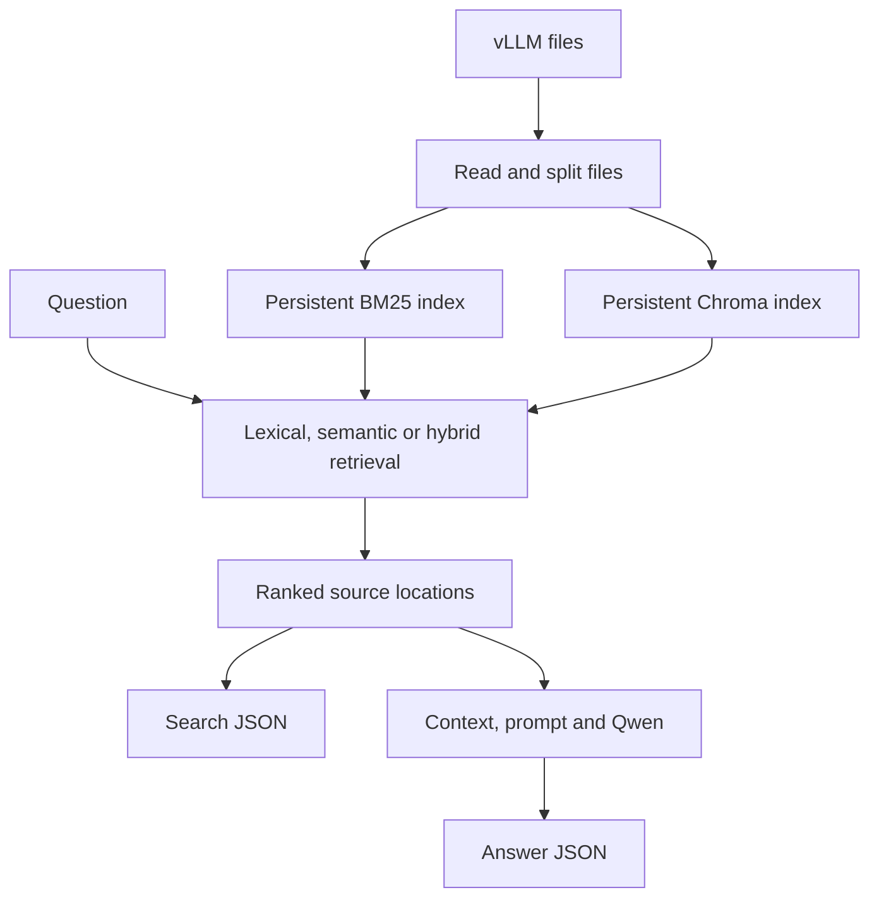

*This project has been created as part of the 42 curriculum by abdfaddo.*

# RAG Against the Machine

## Description

A Retrieval-Augmented Generation (RAG) system for answering questions about the
provided vLLM codebase. It reads source code and documentation, splits them into
chunks, builds a persistent BM25 index, retrieves relevant source locations, and
uses the local `Qwen/Qwen3-0.6B` model to generate answers from those sources.

The mandatory pipeline supports single questions, JSON datasets, and recall@k
evaluation. Optional features add CPU semantic embeddings, hybrid retrieval,
and persistent query-result caching.

## Instructions

### Installation

Requirements: Python `>=3.11,<3.14`, `uv`, and enough disk space for dependencies
and model weights. The model configuration uses CPU execution.

```bash
git clone https://github.com/abfaddoul/RAG-against-the-machine.git
cd RAG-against-the-machine
uv sync
```

Place the supplied vLLM repository in `data/raw/vllm-0.10.1/`. Place the supplied
datasets in `data/datasets/UnansweredQuestions/` and
`data/datasets/AnsweredQuestions/`.

| Path | Purpose |
| --- | --- |
| `src/` | Python implementation and CLI |
| `data/raw/vllm-0.10.1/` | Provided code and documentation |
| `data/datasets/UnansweredQuestions/` | Questions used for batch retrieval |
| `data/datasets/AnsweredQuestions/` | Reference questions and sources |
| `data/processed/` | Generated indexes and query cache |
| `data/output/search_results/<DatasetScope>/` | Batch search JSON |
| `data/output/search_results_and_answer/<DatasetScope>/` | Batch answer JSON |

Run commands from the project root with relative corpus paths. Source paths must
match the reference datasets exactly, including the `data/raw/vllm-0.10.1/`
prefix. Large data files, indexes, outputs, and model weights are excluded from
Git; the evaluation environment supplies or generates them.

### Makefile

| Command | Action |
| --- | --- |
| `make install` | Install dependencies with `uv sync` |
| `make run` | Open the Fire CLI |
| `make debug` | Run the CLI with `pdb` |
| `make clean` | Remove Python and development caches |
| `make lint` | Run Flake8 and the required Mypy checks |
| `make lint-strict` | Run Flake8 and Mypy in strict mode |

`make clean` removes development caches. Query results and indexes are stored
under `data/processed/`; indexing commands clear the query cache when rebuilding.

### Storage on Campus Machines

If the home partition is small, use a larger filesystem for dependency and model
caches before installation or model loading:

```bash
export UV_CACHE_DIR=/goinfre/$USER/.cache/uv
export HF_HOME=/goinfre/$USER/.cache/huggingface
uv sync
```

The first model load downloads weights; later runs reuse the downloaded files.

## Example Usage

Every command follows `uv run python -m src <command> [options]`. Input, index,
and output locations can be configured through CLI arguments.

### Index the Corpus

```bash
uv run python -m src index \
  --corpus_directory data/raw \
  --index_path data/processed/bm25_index.joblib \
  --max_chunk_size 2000
```

### Search One Question

```bash
uv run python -m src search "What is vLLM?" \
  --k 5 \
  --output_path data/output/search.json
```

The command saves JSON and prints its destination. Its default output is
`data/output/search_results/single_query.json`.

### Answer One Question

```bash
uv run python -m src answer "How does vLLM support LoRA?" \
  --k 5 \
  --max_new_tokens 256 \
  --output_path data/output/answer.json
```

The answer and its source locations are saved as JSON; the answer is also printed
in the terminal. The default output is
`data/output/search_results_and_answer/single_query.json`.

Running either single-question command again with the same output path replaces
the previous file. Use a different `--output_path` to keep separate results.

### Search a Dataset

```bash
uv run python -m src search_dataset \
  --dataset_path data/datasets/UnansweredQuestions/dataset_docs_public.json \
  --k 10 \
  --save_directory data/output/search_results/UnansweredQuestions
```

The output keeps the dataset filename. Scope the output directory by dataset type
because the provided answered and unanswered datasets share filenames.

Repeat the command with the supplied source-code dataset path to evaluate code
questions.

### Evaluate Retrieval

The project provides a local recall@k calculation for development:

```bash
uv run python -m src evaluate \
  --student_search_results_path data/output/search_results/UnansweredQuestions/dataset_docs_public.json \
  --dataset_path data/datasets/AnsweredQuestions/dataset_docs_public.json
```

For the official evaluation, run the supplied moulinette separately. Rename the
appropriate platform executable to `moulinette` and give it execution permission:

```bash
chmod +x moulinette
./moulinette evaluate_student_search_results \
  data/output/search_results/UnansweredQuestions/dataset_docs_public.json \
  data/datasets/AnsweredQuestions/dataset_docs_public.json \
  --k 10 \
  --max_context_length 2000
```

The student results are the first argument; the ground-truth dataset is the second.
The project implementation never imports or calls the moulinette.

### Answer a Dataset

```bash
uv run python -m src answer_dataset \
  --student_search_results_path data/output/search_results/UnansweredQuestions/dataset_docs_public.json \
  --save_directory data/output/search_results_and_answer/UnansweredQuestions \
  --max_new_tokens 256
```

This reuses the saved source locations and keeps the dataset filename in the
answer output directory. Long-running chunking, batch retrieval, batch generation,
and embedding operations display progress.

## System Architecture



| Component | Responsibility |
| --- | --- |
| `src/ingestion/` | Discover supported files and read UTF-8 text |
| `src/chunking/` | Split files and preserve exact character spans |
| `src/indexing/` | Tokenize, build, and persist BM25 |
| `src/retrieval/` | Rank chunks and construct search result models |
| `src/generation/` | Read source spans, build prompts, and run Qwen |
| `src/evaluation/` | Compare source paths and spans to calculate recall@k |
| `src/bonus/` | Semantic indexing, semantic search, and hybrid retrieval |
| `src/query_cache.py` | Cache retrieved chunks for repeated queries |
| `src/models.py`, `src/json_io.py` | Validate and serialize pipeline data |
| `src/cli.py` | Expose mandatory commands through Python Fire |

## Chunking Strategy

Ingestion selects `.py`, `.md`, `.rst`, and `.txt` files. It skips empty files,
files that cannot be decoded as UTF-8, and directories such as `.git`, `.venv`,
`__pycache__`, and `node_modules`.

Python uses LangChain's `PythonCodeTextSplitter`; Markdown uses
`MarkdownTextSplitter`; plain text and reStructuredText use
`RecursiveCharacterTextSplitter`. These recursive strategies prefer suitable
structural boundaries while keeping chunk sizes bounded.

The CLI defaults to `--max_chunk_size 2000`. The corpus pipeline applies a tuned
target of `min(max_chunk_size, 1000)` characters, with no overlap. A smaller
argument reduces the target further. Each chunk retains its original text, file
path, start offset, and end offset. The original slice is checked against the
chunk text to prevent incorrect source metadata.

Offsets use Python slicing: `text[first_character_index:last_character_index]`.
The end offset is exclusive. The tuned target keeps retrieved sources below the
moulinette's 2000-character maximum and improves source localization.

## Retrieval Method

The mandatory retriever uses `BM25Okapi` from `rank-bm25`.

At indexing time, each chunk's file path and text are tokenized together. The
tokenizer splits camel-case and acronym boundaries, extracts alphanumeric tokens,
and lowercases them. Including paths gives file names and directory names a role
in lexical matching. The same tokenizer processes questions.

At query time, BM25 scores the indexed chunks. Chunks containing at least one query
token are ranked by descending score, and the top-k source spans are returned.
The index and aligned chunk metadata are persisted using Joblib.

## Data Models and JSON Output

Pydantic validates questions, sources, search results, and generated answers.
The provided models are implemented in `src/models.py`:
`MinimalSource`, `UnansweredQuestion`, `AnsweredQuestion`, `RagDataset`,
`MinimalSearchResults`, `MinimalAnswer`, `StudentSearchResults`, and
`StudentSearchResultsAndAnswer`.

| Command | JSON model |
| --- | --- |
| `search`, `search_dataset` | `StudentSearchResults` |
| `answer`, `answer_dataset` | `StudentSearchResultsAndAnswer` |

Both output models contain `search_results` and the requested `k`. A
single-question output contains one result with its `question_id`, `question`,
and `retrieved_sources`; answer results also contain `answer`. A source records
its exact `file_path`, `first_character_index`, and `last_character_index`.

Single-question commands generate a UUID for the question. Dataset commands
preserve dataset question IDs so evaluation can match results to references.
Searches with no matches still save a result with an empty source list. JSON uses
UTF-8, and missing output directories are created automatically.

## Answer Generation

The system reads the retrieved source spans, labels them with paths and offsets,
and combines them into context. Context construction uses a 12,000-character
limit. This is a character bound, rather than tokenizer-based budget accounting.

LangChain builds system and human chat messages. The prompt asks Qwen to answer
only from the retrieved context and acknowledge insufficient evidence. Generation
uses Hugging Face Transformers through `HuggingFacePipeline` and `ChatHuggingFace`.
The default generation limit is 256 new tokens, configurable with
`--max_new_tokens`.

The prompt requests `/no_think`; generated `<think>...</think>` blocks are removed
before serialization. The model instance is reused within a Python process, so
batch generation loads it once. Answer quality depends on the retrieved evidence
and the capabilities of the small local model.

## Optional Features

### Semantic Embeddings

Semantic indexing uses `sentence-transformers/all-MiniLM-L6-v2` through LangChain's
`HuggingFaceEmbeddings`, with normalized embeddings and CPU batching. Chroma
persists texts and source metadata locally and uses an HNSW index with cosine
distance.

```bash
uv run python -m src index_semantic \
  --corpus_directory data/raw \
  --index_directory data/processed/semantic_index \
  --max_chunk_size 2000 \
  --batch_size 32

uv run python -m src search_semantic \
  "How does vLLM manage the KV cache?" \
  --k 5 \
  --index_directory data/processed/semantic_index
```

Each semantic indexing run resets and rebuilds the complete `rag_chunks`
collection. The query uses the same embedding model as the indexed chunks.

### Hybrid Retrieval

Hybrid search combines BM25 and Chroma using LangChain's `EnsembleRetriever`.
Each retriever provides `max(10, 2 * k)` candidates. Reciprocal Rank Fusion uses
equal weights and `c=60`; source identities combine the path and character span.
The fused list is deduplicated and reduced to the requested top-k.

Build both indexes from the same corpus before using hybrid search:

```bash
uv run python -m src index
uv run python -m src index_semantic

uv run python -m src search_hybrid \
  "How does vLLM manage the KV cache?" \
  --k 5 \
  --index_path data/processed/bm25_index.joblib \
  --semantic_index_directory data/processed/semantic_index
```

The optional `search_semantic` and `search_hybrid` commands display retrieved
chunks in the terminal. The JSON output workflow above applies to the mandatory
search and answer commands.

### Caching

BM25 and Chroma persist their indexes so retrieval can reuse them across runs.
`diskcache` stores retrieved chunks for `search`, `search_semantic`, and
`search_hybrid` under `data/processed/query_cache/`.

Cache keys contain the retrieval mode, resolved index paths, exact query, and k.
A cache hit reuses saved chunks. The `index` and `index_semantic` commands clear
the query cache before rebuilding, including when the subsequent build fails.
After changing corpus files, rebuild the relevant indexes; rebuild both for
hybrid retrieval.

## Performance Analysis

Recorded official public-dataset moulinette results:

| Dataset | Recall@1 | Recall@3 | Recall@5 | Recall@10 | Required Recall@5 |
| --- | ---: | ---: | ---: | ---: | ---: |
| Documentation | 60.0% | 76.0% | 80.0% | 83.0% | 80.0% |
| Source code | 38.4% | 62.6% | 69.7% | 77.8% | 50.0% |

Both public Recall@5 thresholds are reached. These are recorded results from the
tested corpus and configuration, rather than guarantees for different datasets.

A reference source counts as retrieved when the file path matches exactly and
the character spans reach an intersection-over-union of at least 0.05. Recall@k
is averaged across answered questions.

The 1000-character target improved source localization during retrieval tuning.
Smaller chunks provide more precise spans, at the cost of more chunks to index
and score. BM25 precomputes corpus statistics; answer generation and semantic
indexing add model computation on CPU. Query caching avoids repeated retrieval
work for identical search requests.

The subject's mandatory timing targets are at most five minutes for corpus
indexing and at most 90 seconds for 200 retrieval questions. Measure the lexical
pipeline on the evaluation machine; model generation and optional semantic
indexing are separate operations.

## Design Decisions

- **BM25 for the mandatory pipeline:** CPU-friendly lexical ranking matches
  technical identifiers and meets the required retrieval-method choice.
- **Different splitters for code and documentation:** file structure guides
  segmentation, while exact source slices remain verifiable.
- **A tuned 1000-character target:** precise spans improve localization while
  keeping source sizes within the evaluator limit.
- **Pydantic at stage boundaries:** shared models validate JSON inputs and outputs.
- **Separate optional modules:** semantic and hybrid retrieval reuse the same
  source metadata without changing the mandatory BM25 pipeline.
- **Rank fusion for hybrid retrieval:** RRF combines rankings without comparing
  BM25 scores directly to semantic distances.
- **Persistent indexes and query caching:** saved data reduces repeated indexing
  and retrieval work.
- **Configurable paths and generation length:** the same CLI supports development
  and the evaluator's supplied locations.

## Challenges Faced

- **Exact source offsets:** splitter start indices and slice validation preserve
  the character ranges required by evaluation.
- **Recall tuning:** smaller chunks and path-aware tokenization improved matching
  between natural-language questions and code identifiers.
- **Corpus path consistency:** relative paths are kept unchanged because the
  moulinette compares them verbatim.
- **CPU generation and disk limits:** the small Qwen model, process-level model
  reuse, configurable output length, and relocated caches keep the workflow usable
  on campus machines.
- **Qwen thinking markers:** prompt instructions and answer cleaning prevent
  thinking tags from appearing in saved answers.
- **Cache invalidation during rebuilds:** clearing query results before indexing
  avoids serving old cached chunks after a rebuild attempt.

## Validation

Run the mandatory static checks:

```bash
make lint
```

Flake8 and Mypy passed for the final CLI changes. Single-question search and answer
commands were run and produced JSON files. Public-dataset retrieval was checked
with the supplied moulinette; scores are recorded above.

For repeatable validation, rebuild the BM25 index, run `search_dataset`, evaluate
with the moulinette, and run an answer command using the generated sources.

## Resources

- [Retrieval-Augmented Generation for Knowledge-Intensive NLP Tasks](https://arxiv.org/abs/2005.11401)
- [The Probabilistic Relevance Framework: BM25 and Beyond](https://www.staff.city.ac.uk/~sbrp622/papers/foundations_bm25_review.pdf)
- [rank-bm25 implementation](https://github.com/dorianbrown/rank_bm25)
- [Qwen3-0.6B model card](https://huggingface.co/Qwen/Qwen3-0.6B)
- [LangChain documentation](https://docs.langchain.com/)
- [Pydantic documentation](https://docs.pydantic.dev/)
- [Python Fire documentation](https://google.github.io/python-fire/)
- [uv documentation](https://docs.astral.sh/uv/)

### Use of AI

AI assisted with explanations of RAG, BM25, embeddings, source-span evaluation,
and LangChain; implementation reviews; development test ideas; debugging type,
dependency, storage, and model-loading issues; and README drafting. Suggested
changes were checked against the project code and subject requirements. Static
analysis, CLI runs, and the supplied moulinette were used to validate the work.

## Author

- 42 login: `abdfaddo`
- GitHub: [abfaddoul](https://github.com/abfaddoul)
